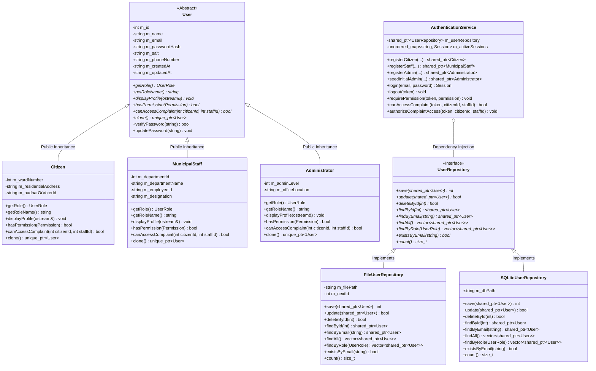

# CivicCare: Member 2 — User Management & Authentication

**Component Owner:** Member 2  
**Domain:** C++ OOP, Role-Based Access Control (RBAC), Authentication & Persistence  
**Languages/Standards:** C++17 / C++14 compliant, standard STL, CMake, MinGW / GCC / Clang / MSVC  

---

## 1. Overview & Goal

Member 2 is responsible for implementing the secure, role-based access engine for **CivicCare**. This subsystem guarantees:
- Complete encapsulation of user records and credentials.
- Pure virtual polymorphic class hierarchy separating **Citizens**, **Municipal Staff**, and **Administrators**.
- Cryptographically sound password protection (**SHA-256** with unique salts; zero plaintext storage).
- Service-level **Role-Based Access Control (RBAC)** preventing unauthorized actions and privilege escalation.
- Clean persistence integration via the abstract `UserRepository` interface, supporting both durability across restarts (**File Streams**) and **SQLite** integration with Member 4.

---

## 2. File Ownership & Structure

All files specified in the project roadmap are implemented and verified:

```
oops project/
├── CMakeLists.txt                              # CMake build definition for integration
├── build_and_test.bat                          # One-click Windows build and test runner
├── README_MEMBER2.md                           # Comprehensive documentation & OOP explanation
│
├── include/
│   ├── exceptions/
│   │   └── CivicCareExceptions.hpp             # Domain exception hierarchy
│   ├── models/
│   │   ├── Administrator.hpp                   # Administrator derived class header
│   │   ├── Citizen.hpp                         # Citizen derived class header
│   │   ├── MunicipalStaff.hpp                  # MunicipalStaff derived class header
│   │   ├── Permission.hpp                      # Discrete RBAC permissions enum
│   │   ├── Role.hpp                            # UserRole enum & string converters
│   │   ├── Session.hpp                         # Authenticated session token tracker
│   │   └── User.hpp                            # Abstract Base Class header
│   ├── repositories/
│   │   ├── FileUserRepository.hpp              # File stream persistent repository header
│   │   ├── SQLiteUserRepository.hpp            # SQLite repository header (Member 4 contract)
│   │   └── UserRepository.hpp                  # Agreed abstract repository interface
│   ├── services/
│   │   └── AuthenticationService.hpp           # Auth, RBAC & user management service
│   └── utils/
│       ├── DateTimeUtils.hpp                   # ISO 8601 timestamp generator
│       ├── Optional.hpp                        # C++14/C++17 portable Optional utility
│       ├── PasswordHasher.hpp                  # SHA-256 cryptographic hashing header
│       └── ValidationUtils.hpp                 # Input sanitization and format validators
│
├── src/
│   ├── models/
│   │   ├── Administrator.cpp                   # Administrator implementation
│   │   ├── Citizen.cpp                         # Citizen implementation
│   │   ├── MunicipalStaff.cpp                  # MunicipalStaff implementation
│   │   ├── Session.cpp                         # Session implementation
│   │   └── User.cpp                            # User base class implementation
│   ├── repositories/
│   │   ├── FileUserRepository.cpp              # File streaming persistence implementation
│   │   └── SQLiteUserRepository.cpp            # SQLite persistence implementation
│   ├── services/
│   │   └── AuthenticationService.cpp           # Authentication and authorization logic
│   └── utils/
│       └── PasswordHasher.cpp                  # FIPS 180-2 SHA-256 & salt engine
│
├── tests/
│   └── test_user_management.cpp                # 8 comprehensive automated unit/integration tests
│
└── demo/
    └── main_member2_demo.cpp                   # Terminal demonstration application
```

---

## 3. Class Hierarchy & Architecture



---

## 4. OOP Concepts Demonstrated (Syllabus Mapping)

| OOP Concept | Implementation in Member 2 | Code Location |
| :--- | :--- | :--- |
| **Data Encapsulation** | All class attributes (`m_id`, `m_name`, `m_email`, `m_passwordHash`, `m_salt`, etc.) are private. Mutators validate invariants. | [User.hpp](file:///c:/Users/Akshay%20Bankar/OneDrive/Desktop/oops%20lab/oops%20project/include/models/User.hpp), [Citizen.hpp](file:///c:/Users/Akshay%20Bankar/OneDrive/Desktop/oops%20lab/oops%20project/include/models/Citizen.hpp) |
| **Abstraction** | Abstract base class `User` defines the pure virtual contracts (`= 0`) without exposing implementation details. `UserRepository` abstracts database storage. | [User.hpp](file:///c:/Users/Akshay%20Bankar/OneDrive/Desktop/oops%20lab/oops%20project/include/models/User.hpp), [UserRepository.hpp](file:///c:/Users/Akshay%20Bankar/OneDrive/Desktop/oops%20lab/oops%20project/include/repositories/UserRepository.hpp) |
| **Inheritance** | Single public inheritance (`class Citizen : public User`, `class MunicipalStaff : public User`, `class Administrator : public User`). Derived classes call base constructors via initializer lists. | [Citizen.cpp](file:///c:/Users/Akshay%20Bankar/OneDrive/Desktop/oops%20lab/oops%20project/src/models/Citizen.cpp), [MunicipalStaff.cpp](file:///c:/Users/Akshay%20Bankar/OneDrive/Desktop/oops%20lab/oops%20project/src/models/MunicipalStaff.cpp), [Administrator.cpp](file:///c:/Users/Akshay%20Bankar/OneDrive/Desktop/oops%20lab/oops%20project/src/models/Administrator.cpp) |
| **Dynamic Polymorphism** | Pure virtual methods (`getRole()`, `getRoleName()`, `displayProfile()`, `hasPermission()`, `canAccessComplaint()`) overridden with `override`. Virtual destructor ensures safe polymorphic cleanup. | [User.hpp](file:///c:/Users/Akshay%20Bankar/OneDrive/Desktop/oops%20lab/oops%20project/include/models/User.hpp), [test_user_management.cpp](file:///c:/Users/Akshay%20Bankar/OneDrive/Desktop/oops%20lab/oops%20project/tests/test_user_management.cpp) |
| **Virtual Copy Constructor** | `virtual std::unique_ptr<User> clone() const = 0;` (Prototype pattern) enables deep copying of polymorphic objects without knowing their exact derived type at compile time. | [User.hpp](file:///c:/Users/Akshay%20Bankar/OneDrive/Desktop/oops%20lab/oops%20project/include/models/User.hpp), [Citizen.cpp](file:///c:/Users/Akshay%20Bankar/OneDrive/Desktop/oops%20lab/oops%20project/src/models/Citizen.cpp) |
| **Operator Overloading** | `friend std::ostream& operator<<(std::ostream& os, const User& user);` polymorphically invokes `user.displayProfile(os)`. | [User.hpp](file:///c:/Users/Akshay%20Bankar/OneDrive/Desktop/oops%20lab/oops%20project/include/models/User.hpp), [User.cpp](file:///c:/Users/Akshay%20Bankar/OneDrive/Desktop/oops%20lab/oops%20project/src/models/User.cpp) |
| **Exception Handling** | Custom exception hierarchy inheriting from `std::runtime_error`: `CivicCareException`, `AuthenticationException`, `DuplicateEmailException`, `ValidationException`, `UnauthorizedException`, `SessionExpiredException`, `RepositoryException`. | [CivicCareExceptions.hpp](file:///c:/Users/Akshay%20Bankar/OneDrive/Desktop/oops%20lab/oops%20project/include/exceptions/CivicCareExceptions.hpp) |
| **Run-Time Type Info (RTTI)** | Safe downcasting using `std::dynamic_pointer_cast<Citizen>(user)` and `std::dynamic_pointer_cast<MunicipalStaff>(user)` during deserialization and testing. | [FileUserRepository.cpp](file:///c:/Users/Akshay%20Bankar/OneDrive/Desktop/oops%20lab/oops%20project/src/repositories/FileUserRepository.cpp), [test_user_management.cpp](file:///c:/Users/Akshay%20Bankar/OneDrive/Desktop/oops%20lab/oops%20project/tests/test_user_management.cpp) |
| **Dependency Injection** | `AuthenticationService` receives `std::shared_ptr<UserRepository>` through its constructor, adhering to SOLID Dependency Inversion Principle. | [AuthenticationService.hpp](file:///c:/Users/Akshay%20Bankar/OneDrive/Desktop/oops%20lab/oops%20project/include/services/AuthenticationService.hpp) |

---

## 5. Security & Role-Based Access Control (RBAC)

### A. Password Protection & Cryptography
1. **Never Stored as Plaintext:** Plaintext passwords exist in memory only during registration or login execution.
2. **Per-User Cryptographic Salt:** Each user receives a 32-character hexadecimal salt generated via high-resolution timing combined with random device entropy (`PasswordHasher::generateSalt`).
3. **FIPS 180-2 SHA-256:** Password hashing computes `SHA-256(salt + "$" + password)`.
4. **Timing Attack Resistant:** `PasswordHasher::verifyPassword` performs constant-time byte-level comparison to prevent side-channel timing leaks.

### B. Privilege Separation Matrix

| Action / Permission | Citizen | Municipal Staff | Administrator |
| :--- | :---: | :---: | :---: |
| `LODGE_COMPLAINT` | **YES** | NO | **YES** |
| `VIEW_OWN_COMPLAINTS` | **YES** | NO | **YES** |
| `REOPEN_OWN_COMPLAINT` | **YES** | NO | **YES** |
| `VIEW_ASSIGNED_COMPLAINTS` | NO | **YES** | **YES** |
| `UPDATE_COMPLAINT_STATUS` | NO | **YES** | **YES** |
| `REASSIGN_COMPLAINT` | NO | **YES** | **YES** |
| `MANAGE_STAFF` | NO | NO | **YES** |
| `MANAGE_DEPARTMENTS` | NO | NO | **YES** |
| `VIEW_ALL_COMPLAINTS` | NO | NO | **YES** |
| `VIEW_ANALYTICS` | NO | NO | **YES** |
| `SYSTEM_BACKUP` / `RESTORE`| NO | NO | **YES** |
| `MANAGE_USERS` | NO | NO | **YES** |

### C. Service-Level Validation (Not Just UI-Hiding)
Permissions are enforced at the service level:
- Calling `requirePermission(token, Permission::MANAGE_STAFF)` with a Citizen token immediately throws `UnauthorizedException`.
- Public registration endpoint `registerCitizen` strictly creates a `Citizen`. A caller cannot supply an Administrator or Staff role.
- `registerStaff` and `registerAdmin` verify that the calling session belongs to an authenticated Administrator.
- `canAccessComplaint(token, citizenId, assignedStaffId)` ensures:
  - A Citizen can **only** inspect complaints where `complaintCitizenId == session.getUserId()`.
  - A Staff member can **only** inspect complaints where `assignedStaffId == session.getUserId()`.
  - An Administrator can inspect all complaints across the municipality.

---

## 6. Persistence & Team Integration

### Coordination with Member 4 (Database & Integration Lead)
Member 2 provides two implementations of the agreed `UserRepository` interface:

1. **`FileUserRepository` (Immediate Zero-Dependency Persistence):**
   - Uses C++ file streams (`std::ifstream`, `std::ofstream`).
   - Serializes polymorphic records and parses them back into their derived types (`Citizen`, `MunicipalStaff`, `Administrator`).
   - Ensures data persists across application shutdowns and restarts.
2. **`SQLiteUserRepository` (Coordinated SQLite Schema):**
   - Matches Member 4's planned database schema:
     ```sql
     CREATE TABLE IF NOT EXISTS users (
         id INTEGER PRIMARY KEY AUTOINCREMENT,
         role TEXT NOT NULL,
         name TEXT NOT NULL,
         email TEXT UNIQUE NOT NULL,
         password_hash TEXT NOT NULL,
         salt TEXT NOT NULL,
         phone TEXT,
         created_at TEXT NOT NULL,
         updated_at TEXT NOT NULL,
         ward_number INTEGER DEFAULT 0,
         residential_address TEXT DEFAULT '',
         aadhar_or_voter_id TEXT DEFAULT '',
         department_id INTEGER DEFAULT 0,
         department_name TEXT DEFAULT '',
         employee_id TEXT DEFAULT '',
         designation TEXT DEFAULT '',
         admin_level INTEGER DEFAULT 1,
         office_location TEXT DEFAULT ''
     );
     CREATE INDEX IF NOT EXISTS idx_users_email ON users(email);
     CREATE INDEX IF NOT EXISTS idx_users_role ON users(role);
     ```

### Coordination with Member 3 (Complaint Lifecycle Lead)
Member 3's `ComplaintService` integrates directly with Member 2's session and permission checks:
```cpp
// Member 3 calls Member 2 to verify access before returning complaint details:
authService->authorizeComplaintAccess(sessionToken, complaint.getCitizenId(), complaint.getAssignedStaffId());
```

---

## 7. Verification & Test Suite Results

The comprehensive test suite in [tests/test_user_management.cpp](file:///c:/Users/Akshay%20Bankar/OneDrive/Desktop/oops%20lab/oops%20project/tests/test_user_management.cpp) tests all aspects of Member 2:

```
=========================================================
    CIVICCARE: MEMBER 2 COMPREHENSIVE TEST SUITE         
    User Management, Authentication & RBAC Verification  
=========================================================

[RUNNING] testPolymorphismAndHierarchy...
[PASSED]  testPolymorphismAndHierarchy

[RUNNING] testPasswordHashing...
[PASSED]  testPasswordHashing

[RUNNING] testInputValidation...
[PASSED]  testInputValidation

[RUNNING] testRegistrationAndDuplicates...
[PASSED]  testRegistrationAndDuplicates

[RUNNING] testAuthenticationAndSessions...
[PASSED]  testAuthenticationAndSessions

[RUNNING] testRBACAndPrivileges...
[PASSED]  testRBACAndPrivileges

[RUNNING] testComplaintAccessRules...
[PASSED]  testComplaintAccessRules

[RUNNING] testPersistenceAcrossRestarts...
[PASSED]  testPersistenceAcrossRestarts

=========================================================
 ALL 8 TEST SUITES PASSED SUCCESSFULLY! (100% SUCCESS) 
=========================================================
```

---

## 8. Build & Execution Instructions

### Option 1: Direct Batch Runner (Windows)
Double-click or run from terminal:
```cmd
build_and_test.bat
```

### Option 2: Direct Command Line (GCC / MinGW / Clang)
**Compile and Run Tests:**
```cmd
g++ -std=c++14 -Iinclude src/models/*.cpp src/repositories/FileUserRepository.cpp src/services/*.cpp src/utils/*.cpp tests/test_user_management.cpp -o test_user_management.exe
.\test_user_management.exe
```

**Compile and Run Live Demo:**
```cmd
g++ -std=c++14 -Iinclude src/models/*.cpp src/repositories/FileUserRepository.cpp src/services/*.cpp src/utils/*.cpp demo/main_member2_demo.cpp -o civiccare_member2_demo.exe
.\civiccare_member2_demo.exe
```

### Option 3: CMake Build (Integrated with Member 4)
```cmd
mkdir build
cd build
cmake ..
cmake --build .
ctest --output-on-failure
```

---

## 9. Definition of Done Checklist (Member 2 Deliverables)

- [x] **Compiling Class Hierarchy:** `User` (abstract base), `Citizen`, `MunicipalStaff`, `Administrator` with pure virtual methods, virtual destructors, and overriding.
- [x] **Polymorphism Demonstration:** Vector of polymorphic user pointers with dynamic method dispatch.
- [x] **Registration & Login Module:** Unique emails, input validation, session token issuance, and logout tracking.
- [x] **Secure Password Hashing:** Salted SHA-256 with constant-time verification. Never plaintext.
- [x] **Privilege Escalation Prevention:** Citizens cannot choose Administrator or Staff roles during public registration.
- [x] **Role-Based Permissions (RBAC):** Citizens limited to their own complaints, staff limited to assigned work, administrators have full access. Enforced at service layer.
- [x] **User Persistence Across Restarts:** File stream repository keeps users durable across shutdowns without an independent duplicate memory store.
- [x] **SQLite Coordination:** Coordinated SQLite repository and DDL matching Member 4's schema contract.
- [x] **Unit & Integration Tests:** 8/8 comprehensive test suites passing.
- [x] **Documentation & Diagrams:** Full OOP concepts explanation, class diagram, and build scripts.
