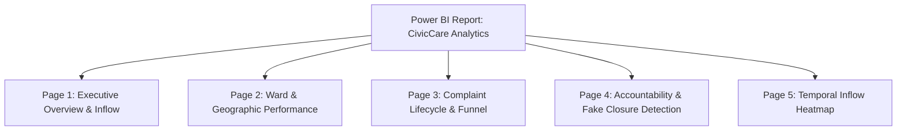

# CitySync / CivicCare — Complete Power BI Dashboard Creation Guide
**Problem Statement 11: Crowdsourced Civic Issue Reporting and Resolution Analytics Dashboard**  
**Role:** Member 1 — Machine Learning & Analytics Pipeline

---

## 1. Dashboard Architecture Overview

The Power BI Dashboard is structured into **4 Executive & Operational Pages** designed to meet all analytical and visual requirements of SIH Problem Statement 11:

---

## 2. Step 1: Importing Datasets into Power BI Desktop

1. Open **Power BI Desktop**.
2. Click **Get Data** $\to$ **Text/CSV**.
3. Import the files from `CitySync/powerbi/data/`:
   - `fact_grievances.csv` (Main fact table)
   - `dim_category.csv` (Category SLA & Department metadata)
   - `dim_ward.csv` (Ward & population metadata)
   - `dim_date.csv` (Calendar table for time intelligence)
   - `fact_hourly_heatmap.csv` (Pre-aggregated Day $\times$ Hour matrix)
   - `fact_lifecycle_funnel.csv` (Lifecycle conversion stages)
4. Click **Load** (or *Transform Data* if you wish to inspect column data types).

---

## 3. Step 2: Establishing Star-Schema Relationships

In the **Model View** tab (left sidebar icon), establish the following relationships by dragging foreign keys to primary keys:

1. `fact_grievances[standard_category]` $\longrightarrow$ `dim_category[category_name]`
   - Cardinality: **Many to One ($* : 1$)** | Cross filter direction: **Single**
2. `fact_grievances[ward]` $\longrightarrow$ `dim_ward[ward_name]`
   - Cardinality: **Many to One ($* : 1$)** | Cross filter direction: **Single**
3. `fact_grievances[created_date]` $\longrightarrow$ `dim_date[Date]`
   - Cardinality: **Many to One ($* : 1$)** | Cross filter direction: **Single**

*(Note: `fact_hourly_heatmap` and `fact_lifecycle_funnel` are independent summary tables for dedicated standalone visuals).*

---

## 4. Step 3: Page-by-Page Visual Design & Setup

---

### Page 1: Executive Overview & Real-Time Inflow

#### A. Top KPI Summary Cards (5 Visual Cards)
1. **Total Complaints:** Card $\to$ Field: `[Total Complaints]`
2. **Resolution Rate:** Card $\to$ Field: `[Resolution Rate %]` (Format as `0.0%`)
3. **Median Resolution Time:** Card $\to$ Field: `[Median Resolution Hours]` (Format as `0.0 hrs`)
4. **SLA Compliance Rate:** Card $\to$ Field: `[SLA Compliance %]` (Format as `0.0%`)
5. **Fake Closure Anomaly Rate:** Card $\to$ Field: `[Fake Closure Rate %]` (Format as `0.0%`)

#### B. Visual 1: Complaints by Civic Category (Donut Chart)
- **Visual Type:** Donut Chart
- **Legend:** `dim_category[category_name]`
- **Values:** `[Total Complaints]`
- **Title:** *Complaint Distribution across 9 Master Civic Categories*

#### C. Visual 2: Inflow by Grievance Channel (Clustered Bar Chart)
- **Visual Type:** Clustered Bar Chart
- **Y-Axis:** `fact_grievances[channel]` (Top 8 channels)
- **X-Axis:** `[Total Complaints]`
- **Data Labels:** On
- **Insight:** Highlights multi-channel fragmentation (Helpline vs. App vs. WhatsApp vs. Web).

#### D. Visual 3: Monthly Inflow & Resolution Trends (Line Chart)
- **Visual Type:** Line and Clustered Column Chart
- **X-Axis:** `dim_date[YearMonth]`
- **Column Values:** `[Total Complaints]` (Inflow)
- **Line Values:** `[SLA Compliance %]`

#### E. Top Slicers
- `dim_category[category_name]` (Dropdown)
- `dim_ward[zone_name]` (Tile / Buttons)
- `dim_date[Date]` (Between Slider)

---

### Page 2: Ward & Geographic Performance Analytics

#### A. Visual 1: Ward-Level Resolution Bottlenecks (Scatter / Dot Plot)
- **Visual Type:** Scatter Chart
- **X-Axis:** `[Complaint Density per 10k Pop]`
- **Y-Axis:** `[Average Resolution Hours]`
- **Values:** `dim_ward[ward_name]`
- **Legend:** `dim_ward[zone_name]`
- **Size:** `[Total Complaints]`
- **Insight:** The **Top-Right Quadrant** immediately isolates chronic bottleneck wards with high complaint volumes and severe delays (e.g., Mahadevapura / Bellandur).

#### B. Visual 2: Zone Performance Matrix (Stacked Bar Chart)
- **Visual Type:** 100% Stacked Bar Chart
- **Y-Axis:** `dim_ward[zone_name]`
- **X-Axis:** `[Complaints Within SLA]` vs. `[Complaints Breaching SLA]`
- **Colors:** Green (`#1E824C`) for Within SLA, Crimson (`#D9381E`) for Breached.

#### C. Visual 3: Ward Ranking Leaderboard (Table / Matrix)
- **Visual Type:** Table
- **Columns:**
  - `dim_ward[ward_name]`
  - `dim_ward[zone_name]`
  - `[Total Complaints]`
  - `[Complaint Density per 10k Pop]`
  - `[Resolution Rate %]`
  - `[SLA Compliance %]`
  - `[Fake Closure Rate %]`
- **Conditional Formatting:** Add data bars to `[Total Complaints]` and color scale to `[SLA Compliance %]`.

---

### Page 3: Complaint Lifecycle & Funnel Analytics

#### A. Visual 1: Complaint Lifecycle Stage Funnel (Funnel Chart)
- **Data Source:** Table `fact_lifecycle_funnel`
- **Category:** `lifecycle_stage`
- **Values:** `complaints_count`
- **Tooltip:** `conversion_pct`
- **Insight:** Visualizes drop-off stages from Filing $\to$ Assignment $\to$ Field Inspection $\to$ Claimed Resolution $\to$ Verified Genuine Closure $\to$ Citizen Reopened.

#### B. Visual 2: Turnaround Time vs. SLA Target by Category (Clustered Column Chart)
- **Visual Type:** Clustered Column Chart
- **X-Axis:** `dim_category[category_name]`
- **Values:**
  - `[Average Resolution Hours]`
  - `AVERAGE(dim_category[sla_target_hours])`
- **Insight:** Directly benchmarks municipal empirical performance against Citizen Charter promises.

#### C. Visual 3: Citizen Reopen Rate by Category (Bar Chart)
- **Visual Type:** Bar Chart
- **Y-Axis:** `fact_grievances[standard_category]`
- **X-Axis:** `[Reopen Rate %]`
- **Insight:** Identifies repeat civic failures (e.g. potholes recurring after superficial asphalt patching).

---

### Page 4: Accountability & Fake-Closure Anomaly Detection

#### A. Visual 1: Ward Zone Fake-Closure Risk Ranking (Bar Chart)
- **Visual Type:** Clustered Bar Chart
- **Y-Axis:** `dim_ward[zone_name]`
- **X-Axis:** `[Fake Closure Rate %]`
- **Data Colors:** Conditional Formatting using `[Fake Closure Alert Status]` (Red for $>10\%$, Amber for $8-10\%$, Green for $<8\%$).

#### B. Visual 2: Anomaly Category Distribution (Treemap)
- **Visual Type:** Treemap
- **Category:** `fact_grievances[anomaly_reason]`
- **Values:** `[Fake Closures Count]`
- **Slices:**
  - *Lazy / Canned Brush-Off* (~77%)
  - *Citizen Dissatisfied (Low Rating)* (~12%)
  - *Future Promise While Closed* (~7%)
  - *Reopened by Citizen* (~4%)

#### C. Visual 3: Suspicious Fast Resolution Outliers (Scatter Plot)
- **Visual Type:** Scatter Chart
- **X-Axis:** `fact_grievances[resolution_time_hours]` (Filtered to $\le 12$ hours)
- **Y-Axis:** `fact_grievances[staff_remarks]`
- **Color:** `fact_grievances[is_fake_closure]`
- **Insight:** Visualizes tickets closed within minutes with minimal remarks like `"."` or `"-"`.

---

### Page 5: Temporal Inflow Heatmap Matrix

#### Matrix Heatmap (Day of Week vs. Hour of Day)
- **Data Source:** Table `fact_hourly_heatmap`
- **Visual Type:** Matrix
- **Rows:** `created_day_name` (Ordered Monday $\to$ Sunday)
- **Columns:** `created_hour` (0 to 23)
- **Values:** `Sum of complaint_inflow_count`
- **Conditional Formatting:** Background color scale with low values as light blue (`#E8F4F8`) and high values as deep navy (`#0B3C5D`).
- **Operational Value:** Enables shift-roster optimization for municipal call centers and field crews during peak Monday morning surges.

---

## 5. Professional Design Palette & Aesthetics

| Element | Hex Code | Purpose |
| :--- | :---: | :--- |
| **Primary Navy** | `#0B3C5D` | Headers, KPI Card Titles, Primary Series |
| **Accent Sky Blue** | `#328CC1` | Secondary Inflow Bars, Trend Lines |
| **Success Emerald** | `#1E824C` | Within SLA, Genuine Resolutions, Normal Status |
| **Warning Amber** | `#E68A00` | Moderate Delay, Pending Citizen Rating |
| **Danger Crimson** | `#D9381E` | SLA Breaches, Fake Closures, High Alert Wards |
| **Background Light Gray** | `#F7F9FB` | Canvas Background |

---

## 6. How to Present This Dashboard to Evaluators

When demonstrating the Power BI dashboard:
1. **Interactive Cross-Filtering:** Click on any category (e.g. *Roads & Infrastructure*) on Page 1 to demonstrate how all KPIs, channel charts, and ward distributions automatically update dynamically.
2. **Citizen Charter Accountability:** Navigate to Page 2 and show how the **Scatter Plot Quadrant** immediately flags under-performing wards without manual calculations.
3. **The ML Integration (Page 4):** Emphasize that the Fake Closure Anomaly rates are driven by our **Machine Learning Anomaly Engine** trained on 1.2M municipal records, providing algorithmic oversight to stop municipal ticket gaming.
